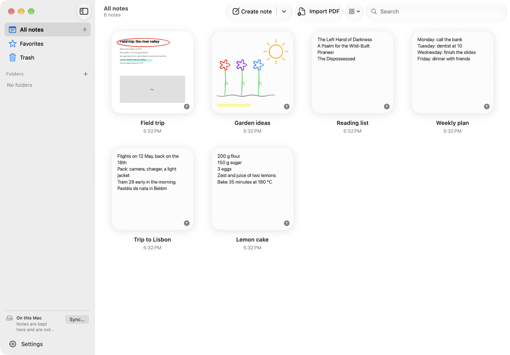
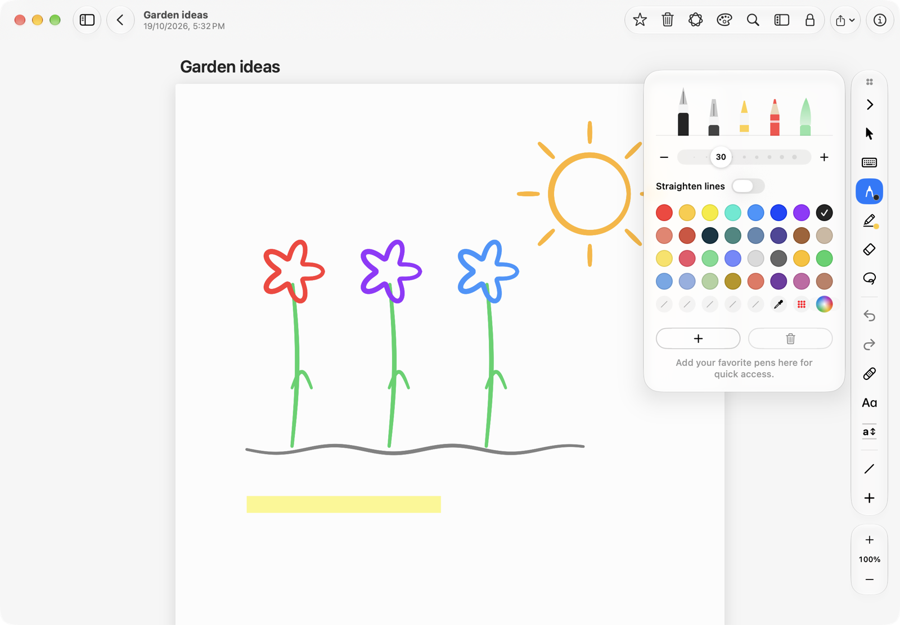
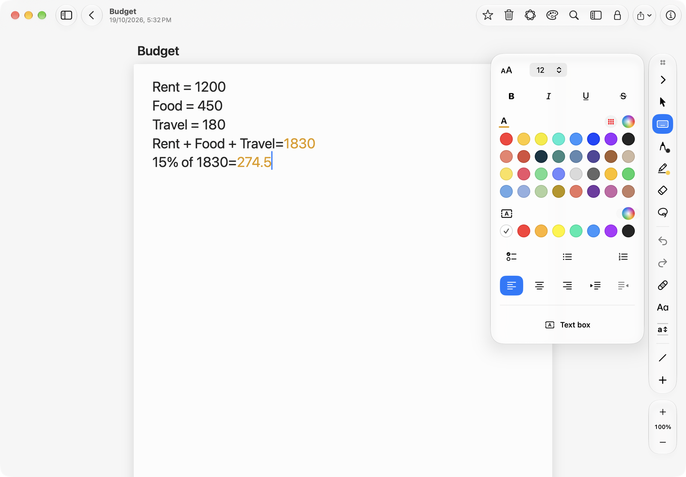
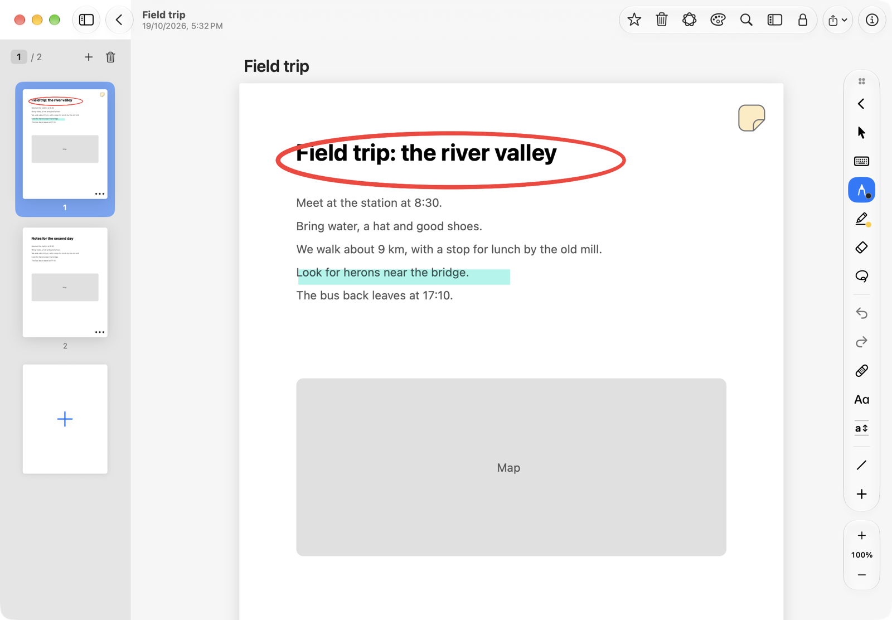
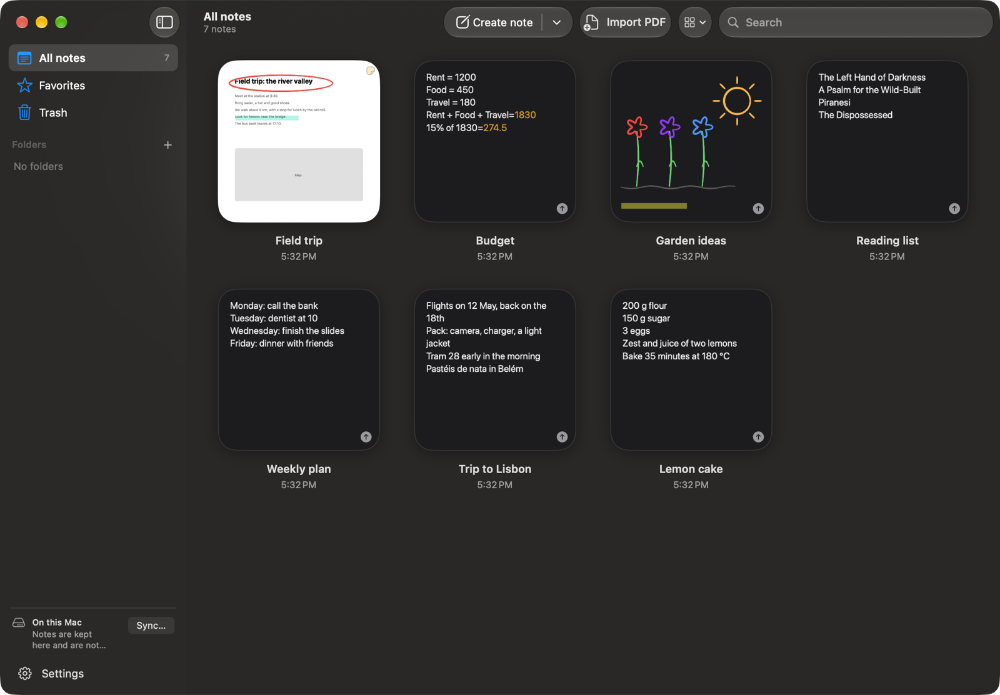

# Inkpage

A native notes app for the Mac, with handwriting, PDFs and the pen tools of Samsung Notes for
Windows, built with SwiftUI for macOS 26. Notes stay on your Mac and can sync through iCloud
Drive, Google Drive or, experimentally, Samsung Cloud, so they also appear in Samsung Notes on
Galaxy phones, tablets and Windows.

> [!WARNING]
> **Inkpage is an independent, unofficial app. It is not made, endorsed, supported or approved by
> Samsung, Apple or Google.**
>
> **Samsung Cloud sync is experimental and is used entirely at your own risk.** It talks to Samsung
> Cloud the way Samsung's own Notes app for Windows does, without Samsung's permission. Samsung's
> terms of service forbid reverse engineering its services and deciphering what is sent to and from
> its servers. Samsung may change or block this at any time, and may suspend or close a Samsung
> account it suspects of breaking its terms, together with the notes in it. Notes can be duplicated,
> changed or lost. The app asks you to read and accept this before Samsung Cloud sync can be turned
> on. Keep backups of anything that matters to you. See [TERMS.md](TERMS.md).



## What it does

- **Typed notes** with styles, colours, highlights, checklists, lists, alignment and indents.
- **Handwriting** with the pens of Samsung Notes for Windows (fountain, calligraphy, pen, pencil,
  brush, highlighter, marker), their sizes, line kinds and colour sets; an eraser that rubs out
  areas or whole strokes; lasso and rectangle selection; a pointer that picks a block of
  handwriting with one click; tape that hides what is under it; and the Easy writing pad, for
  writing large and having it laid small and neat on the page.
- **PDFs**: import a PDF and write on its pages; select its text with ⌥ and drag.
- **Pictures, tables, sticky notes, text boxes and voice recordings** in notes.
- **Pages** at the side, to move between, add, reorder and delete; paper colours and rulings.
- **Apple Intelligence**, on the Mac itself: calculations answered as you type them (`10+5=`
  gives 15, and `15% of 1830=` gives 274.5), *Write with AI* in the toolbar, and the system's
  Writing Tools.
- **Locked notes** behind Touch ID.
- **Sync**: none (notes stay on this Mac), iCloud Drive, Google Drive (a hidden folder of the app's
  own; needs a Google client ID built in), or Samsung Cloud (experimental, see above).

| Handwriting and the pens | Calculations as you type |
|---|---|
|  |  |

| A PDF written on, with its pages | In the dark |
|---|---|
|  |  |

The notes in these pictures were made up for them.

## Privacy

Inkpage has no server, no analytics, no advertising and no tracking. The developer never receives
your notes or account details. Notes are kept in `~/Library/Application Support/Inkpage` and go only
to the sync service you choose, under your own account. Sign-in tokens are kept in the macOS
keychain. Handwriting is recognised on the Mac for search. Read the full
[Privacy Policy](PRIVACY.md).

## Building

Requirements: macOS 26 or later, Xcode 26 (Swift 6). There are no third-party dependencies.

```bash
cd app
swift test                 # the library's tests
./bundle.sh                # build/Inkpage.app, signed with your development identity when there is one
./xcode-build.sh           # the same app built by Xcode (Xcode/SNotes.xcodeproj)
```

`app/README.md` describes the code, the launch options for development and the scripted checks
that drive the running app.

| Path | What it is |
|---|---|
| `app/Sources/SamsungNotesKit` | Everything without a window: the note format, ink, rendering, the local store and sync. |
| `app/Sources/SNotes` | The app itself (SwiftUI and AppKit). |
| `app/Tests/SamsungNotesKitTests` | Library tests, with sanitized test notes in `Fixtures`. |
| `app/Xcode` | The Xcode project that builds `Inkpage.app`. |
| `PRIVACY.md`, `TERMS.md` | The privacy policy and terms of use, the same text the app shows. |

## Licence

Inkpage is **source-available, not open source**. You may read the code and build it for your
own personal evaluation, but not redistribute it, publish builds of it or reuse it without
permission. See [LICENSE](LICENSE) and [THIRD_PARTY_NOTICES.md](THIRD_PARTY_NOTICES.md).

Samsung, Samsung Notes, Samsung Cloud and Galaxy are trademarks of Samsung Electronics Co., Ltd.
Apple, Mac, macOS, iCloud and Apple Intelligence are trademarks of Apple Inc. Google and Google
Drive are trademarks of Google LLC. They are named only to say what the app works with.

## Contact

[hello@krushock.com](mailto:hello@krushock.com)
